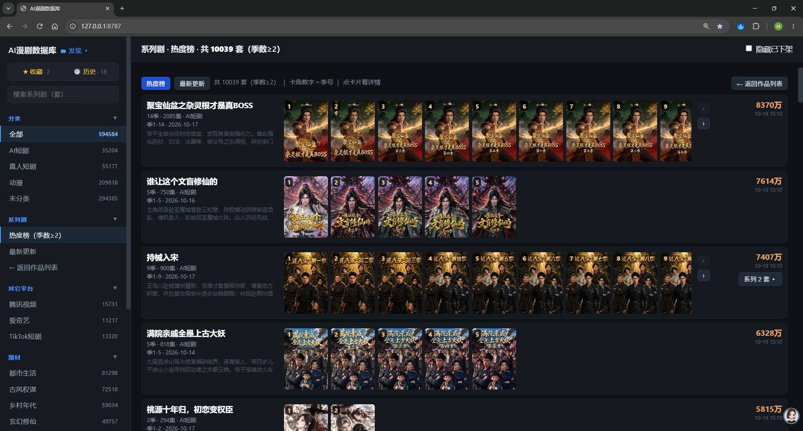

# Hongguo-Sets

红果短剧系列数据表

## 这是什么？

红果短剧的「系列剧」数据表 —— 把同一部剧的多个季（第 1 季、第 2 季……）归成一个「套」。

共 **10,039** 个套，每个套记录「季号 → 该季的红果 series_id」。

## 数据来源

底层数据**全部来自红果短剧 App**（我们库里 59 万部剧都是红果的）。区别只在于「怎么把多季归成一个套」：

| 分组方式 | 数量 | 说明 |
|---|---|---|
| **红果官方 album** | **2,621** | 用红果 App 接口返回的 `related_album_id`（官方专辑/系列 id）直接分组，最权威 |
| **我们自己聚类** | **7,418** | 红果没给 album_id、或我们没用它，改用【封面相似度聚类 + 剧名解析季号】分组 |

> 注：那 7,418 个「我们自己」的套里，有 366 个后来被红果 album 数据**校正过**（补了红果有而我们缺的季、纠正了同季位冲突）。

### 为什么要分两种？

```
· 红果的 related_album_id 能直接告诉「这几季是同一个系列」，但：
    ① 不是每部剧都有 album_id（红果侧约 3.4 万部有，59 万部里大部分没有）
    ② 同一部剧可能有多个 album（如「持械入宋」有 3 个 album，分别是不同版本/上线线）
· 所以我们「双轨」：
    · 红果给了 album_id 且我们之前没有 → 直接用红果官方分组（2,621 套）
    · 其余 → 用封面相似度 + 剧名里的「第 N 季」解析来聚类（7,418 套）
```

## 数据结构

每条 = 一个套，结构是 `{季号: sid}`（季号 → 该季的红果 series_id）。

```json
[
  {"1": "7612345678901234567", "2": "7623456789012345678", "3": "7634567890123456789"},
  ...
]
```

- **键** = 季号（字符串）：`"1"` 第一季、`"2"` 第二季……按升序排
- **值** = 该季的 `series_id`（红果 19 位剧 id，可直接拼播放页 URL）

## 生成方式

本表由 [AI漫剧数据库](https://github.com) 项目生成，不是手写的：

```bash
# 在 AI漫剧数据库 项目里
python tools/export_hongguo_sets.py
```

- 输入：`data/set_feed.json`（系列剧主数据，10,039 套）
- 输出：`data/hongguo_sets.json`（本仓库的数据文件）
- 更新：随日更自动维护（红果新剧上架、新季出现时套数和成员会变）

## 字段说明

| 字段 | 说明 |
|---|---|
| 季号（键） | 第几季，从 1 开始升序 |
| series_id（值） | 该季的红果剧 id，19 位数字字符串 |

